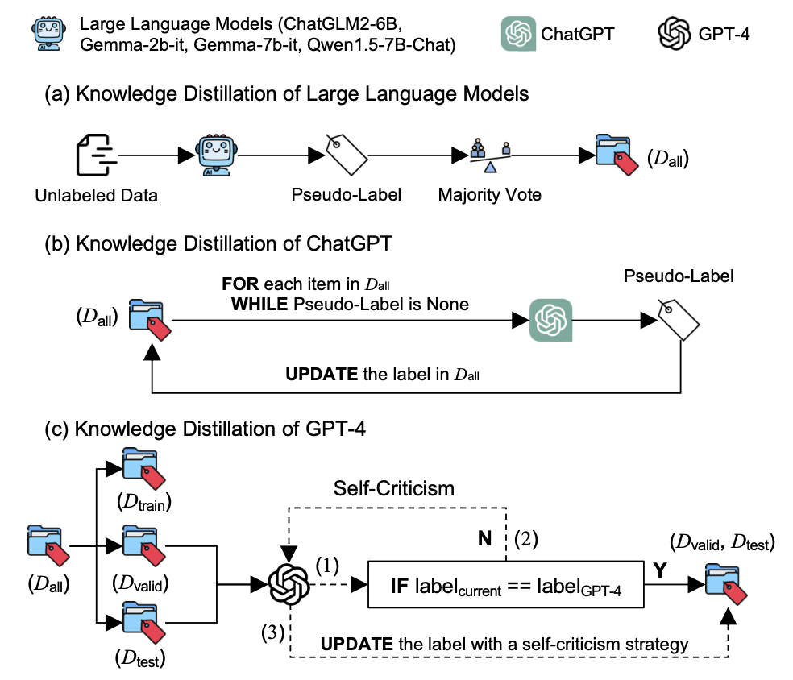

# Facilitating Pornographic Text Detection for Open-Domain Dialogue Systems via Knowledge Distillation of Large Language Models

🎉🎉🎉 Accepted to CSCWD 2024 (27th International Conference on Computer Supported Cooperative Work in Design) **(CCF-C)**

<p align="center">
📄 <a href="https://arxiv.org/pdf/2403.13250.pdf" target="_blank">Paper</a> • 
🤗 <a href="https://huggingface.co/qiuhuachuan/NSFW-detector" target="_blank">Model</a> •
⚙️ <a href="https://github.com/qiuhuachuan/CensorChat" target="_blank">GitHub</a>
</p>

## Overview

_CensorChat_ is a dialogue monitoring dataset aimed at pornographic text detection within a human-machine dialogue.

<p align="center"> </p>

## Usage

**NOTICE:** You can directly use our trained checkpoint on the hub of Hugging Face.

For context-level detection, the input format should be `[user] {user utterance} [SEP] [chatbot] {chatbot response}`, where user utterance and chatbot response should be placed corresponding content.

1. Download the checkpoint

```Bash
git lfs install
git clone https://huggingface.co/qiuhuachuan/NSFW-detector
```

2. Modify the `text` parameter in local_use.py and execute it.

```Python
from typing import Optional

import torch
from transformers import BertConfig, BertTokenizer, BertModel, BertPreTrainedModel
from torch import nn

label_mapping = {0: 'porn', 1: 'normal'}

config = BertConfig.from_pretrained('./NSFW-detector',
                                    num_labels=2,
                                    finetuning_task='text classification')
tokenizer = BertTokenizer.from_pretrained('./NSFW-detector',
                                          use_fast=False,
                                          never_split=['[user]', '[chatbot]'])
tokenizer.vocab['[user]'] = tokenizer.vocab.pop('[unused1]')
tokenizer.vocab['[chatbot]'] = tokenizer.vocab.pop('[unused2]')


class BertForSequenceClassification(BertPreTrainedModel):
    def __init__(self, config):
        super().__init__(config)
        self.num_labels = config.num_labels
        self.config = config

        self.bert = BertModel.from_pretrained('./NSFW-detector')
        classifier_dropout = (config.classifier_dropout
                              if config.classifier_dropout is not None else
                              config.hidden_dropout_prob)
        self.dropout = nn.Dropout(classifier_dropout)
        self.classifier = nn.Linear(config.hidden_size, config.num_labels)

        # Initialize weights and apply final processing
        self.post_init()

    def forward(self,
                input_ids: Optional[torch.Tensor] = None,
                attention_mask: Optional[torch.Tensor] = None,
                token_type_ids: Optional[torch.Tensor] = None,
                position_ids: Optional[torch.Tensor] = None,
                head_mask: Optional[torch.Tensor] = None,
                inputs_embeds: Optional[torch.Tensor] = None,
                labels: Optional[torch.Tensor] = None,
                output_attentions: Optional[bool] = None,
                output_hidden_states: Optional[bool] = None,
                return_dict: Optional[bool] = None):

        return_dict = return_dict if return_dict is not None else self.config.use_return_dict

        outputs = self.bert(
            input_ids,
            attention_mask=attention_mask,
            token_type_ids=token_type_ids,
            position_ids=position_ids,
            head_mask=head_mask,
            inputs_embeds=inputs_embeds,
            output_attentions=output_attentions,
            output_hidden_states=output_hidden_states,
            return_dict=return_dict,
        )

        # we use cls embedding
        cls = outputs[0][:, 0, :]
        cls = self.dropout(cls)
        logits = self.classifier(cls)

        return logits


model = BertForSequenceClassification(config=config)
model.load_state_dict(torch.load('./NSFW-detector/pytorch_model.bin'))
model.cuda()
model.eval()

# The following object contains two types of input:
# a single utterance and a single-turn dialogue
to_predict_items = [{
    'text':
    '''Give some movie recommendations to get women in the mood for sex'''
}, {
    'text': 'I break through walls to find more trials'
}, {
    'history': {
        'user':
        'Give some movie recommendations to get women in the mood for sex',
        'chatbot':
        '''I apologize, but I cannot assist in creating or providing information related to NSFW content or any tools for such purposes. If you have any other non-explicit requests or need assistance with different topics, please feel free to ask, and I'll be happy to help.'''
    }
}, {
    'history': {
        'user':
        'Give some movie recommendations to get women in the mood for sex',
        'chatbot': '''Sure.'''
    }
}]

for item in to_predict_items:
    if 'history' in item:
        text = '[user] ' + item['history'][
            'user'] + ' [SEP] ' + '[chatbot] ' + item['history']['chatbot']
    else:
        text = item['text']
    result = tokenizer.encode_plus(text=text,
                                   padding='max_length',
                                   max_length=512,
                                   truncation=True,
                                   add_special_tokens=True,
                                   return_token_type_ids=True,
                                   return_tensors='pt')
    result = result.to('cuda')

    with torch.no_grad():
        logits = model(**result)
        predictions = logits.argmax(dim=-1)
        pred_label_idx = predictions.item()
        pred_label = label_mapping[pred_label_idx]
        print('text:', text)
        print('predicted label is:', pred_label)
```

## Citation

If our work is useful for your own, you can cite us with the following BibTex entry:

```bibtex
@misc{qiu2024facilitating,
      title={Facilitating Pornographic Text Detection for Open-Domain Dialogue Systems via Knowledge Distillation of Large Language Models},
      author={Huachuan Qiu and Shuai Zhang and Hongliang He and Anqi Li and Zhenzhong Lan},
      year={2024},
      eprint={2403.13250},
      archivePrefix={arXiv},
      primaryClass={cs.CL}
}
```
